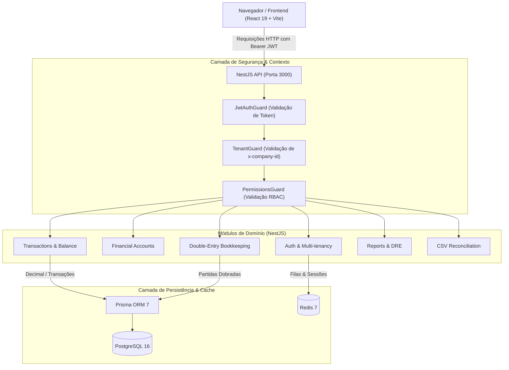
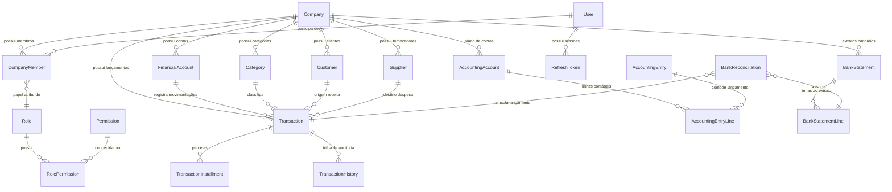

# 💰 SeuDinheiro — ERP Financeiro Web Completo para PMEs

<div align="center">


**Sistema ERP financeiro SaaS comercial para pequenas e médias empresas com partidas dobradas, isolamento multi-tenant estrito, conciliação bancária por CSV com auto-match, fluxo de caixa e relatórios contábeis.**

<br />

[⚡ Início Rápido](#inicio-rapido) • [🏛️ Arquitetura](#arquitetura) • [🗄️ Modelo de Dados](#modelo-de-dados) • [💼 Módulos](#modulos) • [📡 Endpoints da API](#endpoints-api) • [🧪 Testes](#testes)

</div>

---

## 📑 Sumário

- [1. Visão Geral do Projeto](#visao-geral)
- [2. Stack Tecnológica](#stack-tecnologica)
- [3. Arquitetura e Decisões de Engenharia](#arquitetura)
- [4. Modelo de Dados e Diagrama ER](#modelo-de-dados)
- [5. Módulos do Sistema](#modulos)
- [6. Estrutura de Pastas](#estrutura-de-pastas)
- [7. Início Rápido (Passo a Passo)](#inicio-rapido)
  - [Opção A: Executando com Docker](#opcao-a-docker)
  - [Opção B: Executando Sem Docker (Nuvem Gratuita)](#opcao-b-sem-docker)
  - [Inicializando o Backend](#inicializando-backend)
  - [Inicializando o Frontend](#inicializando-frontend)
- [8. Credenciais de Acesso (Usuário Demo)](#credenciais-demo)
- [9. Guia de Endpoints da API](#endpoints-api)
- [10. Execução de Testes Automatizados](#testes)
- [11. Segurança](#seguranca)
- [12. Licença](#licenca)

---

<a id="visao-geral"></a>
## 📌 1. Visão Geral do Projeto

O **SeuDinheiro** é um ERP financeiro web completo, projetado e desenvolvido para simular um produto **SaaS comercial real**. A plataforma permite que diferentes empresas gerenciem suas finanças de maneira 100% isolada e segura, com seus próprios colaboradores, permissões de acesso (RBAC), contas bancárias, clientes, fornecedores e lançamentos operacionais e contábeis.

O projeto foi construído para superar os tradicionais "CRUDs básicos", implementando regras reais de negócios financeiros, tais como:
- **Partidas Dobradas (*Double-Entry Bookkeeping*)**: Validação matemática onde $\sum \text{Débitos} = \sum \text{Créditos}$ antes da persistência de qualquer fato contábil.
- **Precisão Decimal Absoluta**: Proibição de ponto flutuante binário (`Float` IEEE 754) para operações monetárias, utilizando `Decimal(18,2)` para finanças operacionais, `Decimal(18,4)` para contabilidade e `Decimal.js` na camada de aplicação.
- **Isolamento Multi-Tenant Estrito**: Proteção compulsória em banco de dados e filtros de requisição (`TenantGuard`), impedindo vazamento de dados entre empresas.
- **Transferências Atômicas Imutáveis**: Movimentação entre contas bancárias com atualização de saldos em bloco transacional (`prisma.$transaction`) com identificador comum (`transferGroupId`), sem distorcer o fluxo consolidado de receitas e despesas.
- **Conciliação Bancária Inteligente**: Leitura de extratos bancários em formato CSV com algoritmo de *auto-match* automático para correspondência de lançamentos.
- **Trilha de Auditoria & Imutabilidade**: Operações efetivadas são imutáveis; cancelamentos e correções utilizam exclusão lógica e estornos preservando histórico de alterações (`TransactionHistory`).

---

<a id="stack-tecnologica"></a>
## 🛠️ 2. Stack Tecnológica

### Backend
- **Node.js (v24+) & TypeScript 5.7**: Tipagem estática rigorosa (`strict: true`) em ponta a ponta.
- **NestJS 12**: Arquitetura modular corporativa (Controllers, Services, Modules, DTOs com `class-validator`, Guards, Interceptors e Filters globais).
- **Prisma ORM 7**: Modelagem relacional com migrations estruturadas e tipagem gerada estática.
- **PostgreSQL 16**: Banco de dados relacional com integridade referencial, foreign keys e índices compostos.
- **Redis 7 & BullMQ**: Cache e fila de processamento assíncrono para notificações e rotinas de vencimento.
- **Argon2**: Algoritmo de hash de senhas de última geração resistente a ataques de GPU e *side-channel* (OWASP 2024+).
- **JWT & Passport**: Autenticação com Access Token (15 minutos) e Refresh Token rotativo com revogação e hash SHA-256.
- **Swagger / OpenAPI**: Documentação interativa completa disponível nativamente em `/api/docs`.
- **Jest & Supertest**: Testes unitários para regras de negócio e testes de integração de endpoints.

### Frontend
- **React 19 & TypeScript**: Componentização moderna e tipada.
- **Vite 6**: Bundler ultrarrápido com Hot Module Replacement (HMR).
- **Tailwind CSS 4**: Estilização baseada em tokens com suporte a tema claro (*Light*) e escuro (*Dark*).
- **shadcn/ui**: Componentes de interface acessíveis e profissionais.
- **TanStack Query 5 (React Query)**: Gerenciamento inteligente de estado de servidor, cache, invalidação e refetch otimista.
- **Recharts**: Visualização gráfica de evolução financeira mensal e gráficos de pizza/rosca para categorias.
- **React Router 7**: Roteamento client-side com rotas protegidas e controle de layout.
- **Lucide Icons**: Biblioteca consistente de ícones vetoriais.

### Infraestrutura & DevOps
- **Docker & Docker Compose**: Configuração de contêineres para PostgreSQL e Redis com healthchecks automáticos.
- **Docker Multi-Stage**: Imagens de produção otimizadas para deploy em nuvem (Render, AWS, DigitalOcean).

---

<a id="arquitetura"></a>
## 🏛️ 3. Arquitetura e Decisões de Engenharia

O projeto é organizado como um **Monorepo limpo**, separando claramente as responsabilidades de backend, frontend e documentação técnica:



### Decisões Arquiteturais Justificadas:

1. **Por que Decimal.js e `Decimal(18,2)` / `Decimal(18,4)`?**
   O padrão IEEE 754 de números de ponto flutuante em JavaScript (`number`) causa aberrações clássicas como `0.1 + 0.2 = 0.30000000000000004`. Em sistemas financeiros, centavos acumulados geram inconsistências contábeis. Usamos `Decimal.js` com representação decimal arbitrária no backend e `@db.Decimal` no PostgreSQL.
2. **Por que Partidas Dobradas na Contabilidade?**
   Diferente do fluxo de caixa imediato (regime de caixa), a contabilidade por partidas dobradas assegura a rastreabilidade patrimonial: para cada crédito em uma conta de receita ou passivo, deve haver um débito correspondente em ativo ou despesa.
3. **Por que Multi-Tenant por Identificador (`companyId`) com Guard?**
   Em vez de múltiplos bancos de dados (que encarece a infraestrutura para PMEs), usamos o modelo de banco compartilhado com isolamento lógico compulsório. O `TenantGuard` inspeciona a sessão do usuário e bloqueia qualquer operação que tente manipular recursos de empresas alheias.
4. **Por que Argon2 em vez de Bcrypt?**
   Argon2 foi o vencedor da *Password Hashing Competition* e é a recomendação oficial atual da OWASP devido à sua memória configurável, impedindo ataques com hardware dedicado (GPUs/ASICs).

---

<a id="modelo-de-dados"></a>
## 🗄️ 4. Modelo de Dados e Diagrama ER

A modelagem de dados foi desenhada para garantir escalabilidade e integridade referencial:



---

<a id="modulos"></a>
## 💼 5. Módulos do Sistema

### 5.1. Autenticação & Multi-Tenancy (`src/auth/`)
- Cadastro unificado de nova empresa e seu respectivo usuário Administrador inicial.
- Login com verificação de bloqueio anti-força bruta (bloqueio por 15 minutos após 5 erros).
- Tokens JWT de curta duração (15m) + rotação transparente de Refresh Tokens (7 dias).
- Logout com revogação explícita do token.
- Troca de senha com hash Argon2 e revogação das sessões anteriores.

### 5.2. Gestão de Empresas & RBAC (`src/companies/`)
- Suporte a múltiplos papéis na empresa:
  - **`ADMIN`**: Acesso total a todas as funções e configurações.
  - **`FINANCEIRO`**: Acesso a contas, transações, conciliação e relatórios.
  - **`OPERADOR`**: Cadastro de lançamentos e consulta.
  - **`VISUALIZADOR`**: Acesso somente leitura para auditoria externa.
- Convite e adição de novos colaboradores por e-mail com atribuição de papéis.

### 5.3. Contas Financeiras & Transferências (`src/financial-accounts/`)
- Cadastro de Conta Corrente, Poupança, Dinheiro em Caixa e Carteiras Digitais.
- Consulta de saldo disponível em tempo real.
- Extrato detalhado de movimentações por período.
- **Transferência Atômica**: Movimentação entre duas contas executada dentro de uma transação com débito na origem, crédito no destino e gravação de um `transferGroupId` comum.

### 5.4. Lançamentos Financeiros (`src/transactions/`)
- Cadastro de Receitas e Despesas com data de competência e data de vencimento.
- Suporte a parcelamento com geração de parcelas individuais (`TransactionInstallment`).
- **Regra de Saldo Efetivo**: Apenas transações com status `PAID` ou `RECEIVED` debitam ou creditam os saldos das contas. Lançamentos `PENDING` ou `CANCELLED` não alteram o saldo disponível.
- Ação de liquidação rápida (`/settle`) com crédito/débito automático em conta.
- Exclusão lógica (`deletedAt`) com estorno automático do valor se a transação já estava liquidada.

### 5.5. Dashboard & Indicadores (`src/dashboard/`)
- **Saldo Total Consolidado**: Soma do saldo em todas as contas ativas.
- **Receitas e Despesas do Mês**: Totais realizados no mês corrente.
- **Resultado Operacional (DRE Gerencial)**: Superávit ou déficit no período.
- **Alertas de Inadimplência e Vencimento**: Valores a receber e a pagar vencidos e a vencer.
- **Gráficos Recharts**: Evolução dos últimos 6 meses e distribuição de despesas por categoria.

### 5.6. Contabilidade em Partidas Dobradas (`src/accounting/`)
- Plano de contas hierárquico com classificação: Ativo, Passivo, Patrimônio Líquido, Receitas e Despesas.
- Registro de fatos contábeis (`AccountingEntry`) onde:
  $$\sum \text{Débitos} = \sum \text{Créditos}$$
- Cálculo de saldo contábil dinâmico respeitando o saldo normal de cada conta (Débito para Ativos/Despesas e Crédito para Passivos/Receitas/Patrimônio).

### 5.7. Conciliação Bancária por Extrato CSV (`src/reconciliation/`)
- Upload de arquivos de extrato bancário padrão CSV.
- Processamento linha a linha de datas, descrições e valores.
- **Algoritmo de Auto-Match**: Procura lançamentos existentes na mesma conta com o mesmo valor para conciliação automática.
- Conciliação manual de divergências pelo operador.

### 5.8. Relatórios & Exportação (`src/reports/`)
- **DRE (Demonstração do Resultado do Exercício)**: Visão contábil detalhada por competência.
- **Relatório de Inadimplência**: Listagem de clientes com valores em atraso e contagem de dias de atraso.
- **Exportação CSV / Excel**: Download direto de arquivo CSV formatado com separador `;` e codificação UTF-8 com BOM (abrindo perfeitamente no Excel no Windows sem erros de acentuação).

---

<a id="estrutura-de-pastas"></a>
## 📁 6. Estrutura de Pastas

```text
SeuDinheiro/
├── backend/
│   ├── prisma/
│   │   ├── schema.prisma           # Modelagem de dados completa (20+ entidades)
│   │   └── seed.ts                 # Carga de permissões, papéis, categorias e demo
│   ├── src/
│   │   ├── accounting/             # Partidas dobradas e plano de contas
│   │   ├── audit/                  # Trilha de auditoria
│   │   ├── auth/                   # Autenticação JWT, Refresh Token e Argon2
│   │   ├── cash-flow/              # Fluxo de caixa previsto vs realizado
│   │   ├── categories/             # Categorias financeiras
│   │   ├── common/                 # Guards (JWT, Tenant, RBAC), Filters e Decorators
│   │   ├── companies/              # Gestão multi-tenant e membros da empresa
│   │   ├── contacts/               # Clientes e Fornecedores
│   │   ├── dashboard/              # Agregação de métricas e gráficos
│   │   ├── financial-accounts/     # Contas bancárias e transferências atômicas
│   │   ├── notifications/          # Central de notificações e avisos
│   │   ├── prisma/                 # Módulo de banco de dados global
│   │   ├── reconciliation/         # Conciliação bancária por arquivo CSV
│   │   ├── reports/                # DRE, inadimplência e exportação CSV
│   │   ├── transactions/           # Receitas, despesas, parcelas e saldo efetivo
│   │   ├── app.module.ts           # Módulo principal da aplicação
│   │   ├── health.controller.ts    # Health check da API e do banco
│   │   └── main.ts                 # Bootstrap com Swagger, validações e CORS
│   ├── test/                       # Testes de integração E2E
│   ├── Dockerfile                  # Imagem de produção Node.js
│   ├── package.json
│   └── tsconfig.json
├── frontend/
│   ├── src/
│   │   ├── api/                    # Cliente HTTP com interceptor de token
│   │   ├── components/layout/      # Sidebar, Header, tema Dark/Light
│   │   ├── features/               # Módulos do frontend por funcionalidade
│   │   │   ├── accounts/           # Gestão de contas e modal de transferência
│   │   │   ├── auth/               # Telas de login e cadastro de empresa
│   │   │   ├── dashboard/          # Painel com gráficos Recharts e KPIs
│   │   │   ├── reconciliation/     # Upload e conferência de extrato CSV
│   │   │   ├── reports/            # Visualização de DRE e download de relatórios
│   │   │   └── transactions/       # Tabela de lançamentos e modal de novo registro
│   │   ├── App.tsx                 # Roteamento central com React Router 7
│   │   ├── index.css               # Design tokens Tailwind CSS 4
│   │   └── main.tsx                # Bootstrap do React 19 com TanStack Query
│   ├── index.html
│   ├── vite.config.ts
│   └── package.json
├── docs/                           # Documentação detalhada
│   ├── ARCHITECTURE.md             # Especificação arquitetural
│   ├── DATABASE.md                 # Dicionário do banco de dados
│   └── API.md                      # Referência dos endpoints REST
├── docker-compose.yml              # Serviços de PostgreSQL 16 e Redis 7
├── .env.example                    # Modelo de variáveis de ambiente
└── README.md                       # Documentação principal do projeto
```

---

<a id="inicio-rapido"></a>
## 🚀 7. Início Rápido (Passo a Passo)

### Pré-requisitos
- **Node.js**: versão 24 ou superior instalada ([nodejs.org](https://nodejs.org/)).
- **npm** (incluso com o Node.js).
- **PostgreSQL e Redis**: Via Docker **OU** via Nuvem gratuita (explicado abaixo).

---

<a id="opcao-a-docker"></a>
### Opção A: Executando com Docker (Recomendado)

Se você tem o **Docker Desktop** instalado:

1. Suba os contêineres do PostgreSQL e Redis em segundo plano:
   ```bash
   cd SeuDinheiro
   docker compose up -d
   ```

2. Copie o arquivo de variáveis de ambiente do backend:
   ```bash
   cp .env.example backend/.env
   ```

---

<a id="opcao-b-sem-docker"></a>
### Opção B: Executando Sem Docker (Nuvem Gratuita)

Se você **não** tem o Docker instalado no computador:

1. **PostgreSQL Gratuito**: Crie uma conta no [neon.tech](https://neon.tech) e crie um projeto (`seudinheiro`). Copie a URL de conexão (`postgresql://...`).
2. **Redis Gratuito**: Crie uma conta no [upstash.com](https://upstash.com) e crie um Redis. Copie a `REDIS_URL`.
3. Abra o arquivo `backend/.env` e configure:
   ```env
   DATABASE_URL="sua_url_do_neon_aqui?sslmode=require"
   REDIS_URL="sua_url_do_upstash_aqui"
   JWT_SECRET="seu-segredo-jwt-aqui-123456"
   PORT=3000
   ```

---

<a id="inicializando-backend"></a>
### 3. Rodando as Migrations e Inicializando o Backend

No terminal, acesse a pasta do backend e execute os comandos:

```bash
cd backend

# 1. Instalar as dependências
npm install

# 2. Executar as migrations do Prisma no banco
npx prisma migrate dev --name init

# 3. Executar o seed com os dados iniciais
npx prisma db seed

# 4. Iniciar o servidor em modo de desenvolvimento
npm run start:dev
```

> 🟢 **Backend iniciado com sucesso!**
> - **API REST**: `http://localhost:3000/api`
> - **Documentação Swagger**: `http://localhost:3000/api/docs`
> - **Health Check**: `http://localhost:3000/api/health`

---

<a id="inicializando-frontend"></a>
### 4. Inicializando o Frontend

Abra uma **nova janela do terminal**, acesse a pasta do frontend e execute:

```bash
cd frontend

# 1. Instalar as dependências
npm install

# 2. Iniciar o servidor Vite
npm run dev
```

> 🟢 **Frontend pronto!**
> - Acesse no seu navegador: **`http://localhost:5173`**

---

<a id="credenciais-demo"></a>
## 🔑 8. Credenciais de Acesso (Usuário Demo)

O seed inicial já cria uma empresa completa com dados de demonstração:

| Campo | Valor |
|---|---|
| **E-mail** | `admin@demo.com` |
| **Senha** | `senha123` |
| **Empresa Vinculada** | Demo Corp (CNPJ: `12.345.678/0001-00`) |
| **Papel** | `ADMIN` (Acesso irrestrito a todas as funcionalidades) |

---

<a id="endpoints-api"></a>
## 📡 9. Guia de Endpoints da API

A documentação interativa Swagger está disponível em `http://localhost:3000/api/docs`. Abaixo estão os principais endpoints agrupados:

### Autenticação & Sessão
- `POST /api/auth/register-company`: Cadastro completo de nova empresa e seu administrador.
- `POST /api/auth/login`: Autenticação e obtenção de Access Token e Refresh Token.
- `POST /api/auth/refresh`: Renovação do token JWT com rotação e revogação.
- `POST /api/auth/logout`: Revogação da sessão.
- `GET /api/auth/profile`: Retorna dados do usuário autenticado e suas empresas.

### Contas Financeiras & Transferências
- `GET /api/accounts`: Listagem de contas com saldo atual.
- `POST /api/accounts`: Criação de nova conta financeira.
- `POST /api/accounts/transfer`: Transferência atômica entre contas.
- `GET /api/accounts/:id/statement`: Extrato de movimentações da conta.

### Lançamentos Financeiros (Receitas & Despesas)
- `GET /api/transactions`: Listagem com filtros avançados (tipo, status, conta, competência, busca).
- `POST /api/transactions`: Criação de receita ou despesa (com suporte a parcelas).
- `POST /api/transactions/:id/settle`: Baixa de pagamento/recebimento com crédito/débito em conta.
- `DELETE /api/transactions/:id`: Cancelamento lógico com reversão transacional de saldo.

### Dashboard & Fluxo de Caixa
- `GET /api/dashboard/overview`: Indicadores do mês, saldo consolidado, evolução e categorias.
- `GET /api/cash-flow`: Fluxo de caixa diário/mensal (realizado vs. previsto).

### Contabilidade (Partidas Dobradas)
- `GET /api/accounting/accounts`: Consulta do plano de contas com saldos calculados.
- `POST /api/accounting/entries`: Lançamento contábil com validação rigorosa ($\sum Débito = \sum Crédito$).

### Relatórios & Conciliação
- `GET /api/reports/dre`: DRE gerencial do período.
- `GET /api/reports/overdue`: Relatório de inadimplência de clientes.
- `GET /api/reports/export/csv`: Exportação de lançamentos em CSV com cabeçalho compatível com Excel.
- `POST /api/reconciliation/import`: Upload de extrato bancário CSV com algoritmo de auto-match.

---

<a id="testes"></a>
## 🧪 10. Execução de Testes Automatizados

O sistema conta com suíte de testes unitários para validar a lógica de negócios e as regras financeiras:

```bash
cd backend

# Executar todos os testes unitários
npm test

# Executar testes em modo watch
npm run test:watch

# Executar com relatório de cobertura de código
npm run test:cov
```

### O que os testes cobrem:
- **`accounting.service.spec.ts`**: Rejeição de lançamentos contábeis desbalanceados ($\sum Débitos \neq \sum Créditos$) e aceitação de lançamentos equilibrados.
- **`financial-accounts.service.spec.ts`**: Validação de transferências para a mesma conta, bloqueio de valores negativos e execução de transferências atômicas debitando origem e creditando destino.
- **`transactions.service.spec.ts`**: Garantia de que transações `PENDING` não alteram o saldo disponível e que transações `PAID`/`RECEIVED` afetam o saldo imediatamente.

---

<a id="seguranca"></a>
## 🔒 11. Segurança

O projeto segue as diretrizes da **OWASP Top 10**:
- **Criptografia de Senhas**: Hash com Argon2 e salt aleatório.
- **Proteção contra Brute Force**: Bloqueio de 15 minutos após 5 tentativas consecutivas de login incorreto.
- **Rotação de Refresh Tokens**: Prevenção de roubo de sessão através de hashes SHA-256 no banco e revogação no logout.
- **Sanitização de Dados**: `ValidationPipe` do NestJS com `whitelist: true` e `forbidNonWhitelisted: true`, eliminando payloads maliciosos.
- **Proteção contra SQL Injection**: Uso do Prisma ORM com queries parametrizadas.
- **Trilha de Auditoria**: Registro imutável de quem alterou o quê e quando em `TransactionHistory` e `AuditLog`.

---

<a id="licenca"></a>
## 📄 12. Licença

Este projeto foi desenvolvido para fins educacionais e de demonstração de competências de engenharia de software para vagas de **Desenvolvedor Full Stack** e **Desenvolvedor Backend**.

Distribuído sob a licença **MIT**. Consulte `LICENSE` para obter mais informações.
